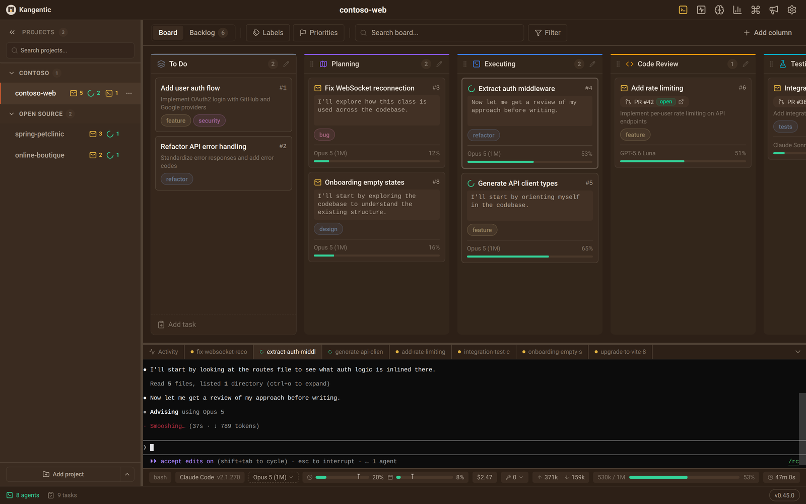

<!-- readme-translation source-blob=addf4d308ea2879895590819a96e54c47a323ac9 -->
> Ez a(z) [README.md](../README.md) gépi fordítása a(z) `addf4d3` állapot szerint. Az angol változat a mérvadó.

<p align="center">
  <a href="https://www.kangentic.com"></a>
</p>

<h1 align="center">Kangentic</h1>

<p align="center">
  <strong>Húzz el egy kártyát. Elindul egy ágens.</strong><br />
  Ágensalapú fejlesztői környezet MI-kódolóágensekhez.
</p>

<p align="center">
  <a href="https://github.com/Kangentic/kangentic/releases/latest"></a>
  <a href="https://www.npmjs.com/package/kangentic"></a>
  <a href="../LICENSE"></a>
</p>

<p align="center">
  <a href="https://kangentic.github.io/kangentic/">
    <picture>
      <source media="(prefers-color-scheme: dark)" srcset="https://raw.githubusercontent.com/Kangentic/kangentic/main/docs/images/readme-board-dark.png" />
      <source media="(prefers-color-scheme: light)" srcset="https://raw.githubusercontent.com/Kangentic/kangentic/main/docs/images/readme-board-light.png" />
      
    </picture>
  </a>
</p>

<p align="center">
  <a href="https://kangentic.github.io/kangentic/">Élő demó</a> |
  <a href="https://www.kangentic.com/getting-started/">Gyors kezdés</a> |
  <a href="https://www.kangentic.com/overview/">Dokumentáció</a>
</p>

<!-- language-switcher -->
<p align="center">
  <a href="../README.md">English</a> |
  <a href="README.zh-CN.md">中文(简体)</a> |
  <a href="README.zh-TW.md">中文(繁體)</a> |
  <a href="README.fr.md">Français</a> |
  <a href="README.de.md">Deutsch</a> |
  <a href="README.it.md">Italiano</a> |
  <a href="README.es.md">Español</a> |
  <a href="README.ja.md">日本語</a> |
  <a href="README.ko.md">한국어</a> |
  <a href="README.ru.md">Русский</a> |
  <a href="README.pt-BR.md">Português (Brasil)</a> |
  <a href="README.tr.md">Türkçe</a> |
  <a href="README.pl.md">Polski</a> |
  <a href="README.cs.md">Čeština</a> |
  Magyar
</p>
<!-- /language-switcher -->

## Mit csinál?

Egy kódolóágens önállóan is végig tud vinni egy feladatot, a git worktree-k pedig lehetővé teszik, hogy egyszerre több is fusson. Ekkor már te vagy a szűk keresztmetszet: melyik ágens vár egy promptra, melyik végzett, és mi lett az egyes ágakkal. A Kangentic minden munkamenetet egyetlen táblára tesz, és megjelöli azokat, amelyek rád várnak.

### Futtasd az ágenseidet egyetlen tábláról

- **Egy tábla, minden ágens.** Minden kártya mutatja a modellt, a kontextusablak kihasználtságát és az ágens utolsó üzenetét, a rád várókat pedig megjelöli.
- **Kangentic Mobile.** Párosítsd egyszer a telefonodat, és utána az asztalodtól távol is ránézhetsz az ágensekre, megválaszolhatod a kérdést, amelynél egy ágens megállt, és átnézheted a diffjét. A kapcsolat végpontok közötti titkosítással működik, a Kangentic továbbítószerverén vagy egy saját üzemeltetésűn keresztül. Töltsd le az [App Store-ból](https://apps.apple.com/app/kangentic/id6794952339) vagy a [Google Play-ről](https://play.google.com/store/apps/details?id=com.kangentic.mobile).
- **Tizenöt ágens-CLI.** Tervezz a Claude Code-dal, és építs a Codexszel, vagy használj mindenhol egyetlen CLI-t. A Kangentic a már meglévő CLI-jeidet futtatja a már beállított hitelesítő adataiddal. Nincs API-kulcs, nincs proxy, nincs Kangentic-fiók.
- **Ágensek távoli gépen.** Helyezz egy projektet egy SSH-n keresztül elérhető Linux-gépre, és annak repója, ágensei, buildjei és tesztjei ott futnak. A tábla a saját számítógépeden marad, az ágensek pedig megszakadt kapcsolat esetén vagy az alkalmazásból való kilépés után is tovább dolgoznak. A beállításról és a korlátozásokról lásd: [SSH távoli gépek](https://www.kangentic.com/features/ssh-remote-hosts/).
- **Minden projekt egy helyen.** Minden repó saját táblát kap, az Ágensfigyelő pedig az összes táblán futó ágenseket mutatja.
- **Áttekintés a táblán.** A Módosítások panel megmutatja minden feladat diffjét és commitelőzményeit. A GitHubon vagy az Azure DevOps-ban lévő csatolt pull request mutatja az állapotát, és azt, hogy egyesíthető-e.
- **Ingyenes és nyílt forráskódú.** AGPL-3.0 licenc, minden funkcióval és fizetős csomag nélkül.

### A munkafolyamat alakítása

- **Oszlopok.** Nevezd át, add hozzá és kösd át az oszlopokat, amíg a tábla a te kiadási folyamatodhoz nem igazodik. Minden oszlophoz saját ágens, modell, erőfeszítés és engedélymód tartozik. A beállítás a repóval együtt kerül commitolásra a `kangentic.json` fájlban, így a csapattársak ugyanazt a táblát kapják, a feladatok és az ágensmunkamenetek viszont mindenki saját gépén maradnak.
- **Automatizálások.** Amikor egy feladat belép egy oszlopba, amikor az ágense befejez egy kört, vagy amikor a feladat elhagyja az oszlopot, az oszlop üzenetet vagy perjeles parancsot küldhet az ágensnek, szkriptet futtathat, webhookot hívhat, értesíthet téged, vagy a következő oszlopba helyezheti a feladatot. Egy hétköznapi nyelven megfogalmazott feltétel, amelyet egy ágens ellenőriz, dönti el, hogy egy lépés lefut-e.
- **Munkafolyamatok.** Adj egy rövid leírást a munkafolyamat-ágensnek, nézd át az általa megtervezett, egymáshoz kapcsolt feladatokat, és nyomd meg az Indítás gombot. Minden feladat akkor indul, amikor azok a feladatok, amelyekre vár, a Kész oszlopba érnek, és egy munkafolyamat több projektre is kiterjedhet.
- **A táblán dolgozó ágensek.** A Kangentic MCP-szervere lehetővé teszi, hogy egy futó ágens feladatokat hozzon létre, áthelyezze a saját kártyáját, korábbi beszélgetésekben keressen, és üzenetet küldjön egy másik feladat ágensének, így egy promptban megírt szabály is továbbviheti a munkát.

## Neked való?

**Jól illik hozzád, ha:**

- egyszerre több kódolóágenst futtatsz, és elveszíted a fonalat, hogy melyik vár rád.
- több projekt vagy ügyfél között zsonglőrködsz a feladatokkal, és minden ágenst egyetlen nézetben szeretnél látni.
- a Claude Code-ot, a Codexet és más CLI-ket szeretnéd vegyesen használni a már előfizetett csomagjaidon.
- többlépéses munkafolyamatod van, és projektenként szeretnéd testre szabni az ágenseit és automatizálásait.
- a telefonodról szeretnél válaszolni az ágenseidnek, amikor nem vagy a gépnél.

**Valószínűleg nem neked való, ha:**

- szívesebben dolgozol egyszerre egy feladaton, az elejétől a végéig.
- egyetlen projekten dolgozol, és ritkán váltasz.
- nem használsz ágens-CLI-ket, vagy jobban kedveled az olyan alkalmazásokat, mint a Cursor vagy a Claude Desktop.
- a fejlesztési módszeredben nincs szükséged munkafolyamatokra vagy automatizálásokra.
- olyan üzemeltetett szolgáltatást szeretnél, amely futtatja az ágenseidet, telepítendő alkalmazás nélkül.

Ha hasznosnak tűnik, egy ⭐ segít más fejlesztőknek megtalálni a Kangenticet.

## Telepítés

```bash
npx kangentic
```

Ez letölti a platformodhoz tartozó legújabb kiadást a [GitHub Releases](https://github.com/Kangentic/kangentic/releases/latest) oldalról, telepíti és megnyitja. Ezután az alkalmazás magától frissül. A telepítők a kiadások oldalán is elérhetők, ha inkább magad futtatnád valamelyiket.

**Követelmények**

- Windows x64, macOS 13 vagy újabb Apple Siliconon vagy Intelen, illetve Linux x64 vagy arm64 (`.deb` vagy `.rpm`).
- Node.js 20 vagy újabb az `npx`-hez, valamint Git 2.26 vagy újabb.
- Legalább egy [támogatott ágens-CLI](#supported-agents), telepítve és bejelentkezve.

A WSL-felhasználók a Windows-verziót telepítik, és terminálhéjként kiválaszthatnak egy WSL-disztribúciót. A disztribúción belül telepített ágens-CLI ott fut, ha az elérési útját a disztribúcióban lévő példányra állítod. Magát a projektet tartsd Windows-meghajtón. A [telepítési útmutató](https://www.kangentic.com/guide/installation/) minden platformot ismertet.

## Hogyan működik?

1. **Állítsd be a táblát.** Tartsd meg az alapértelmezett oszlopokat, vagy alakítsd át őket, és válaszd ki, melyik ágenst és engedélymódot futtassa mindegyik.
2. **Hozz létre egy feladatot.** Adj neki címet és promptot, vagy importáld a GitHub Issues-ból, a GitHub Projects-ből, az Azure DevOps-ból, az Asana-ból, a Jira-ból, a Linearből, a Trello-ból, a GitLabből vagy egy Obsidian-tárolóból.
3. **Húzd át a futtatáshoz.** A Kangentic létrehozza a worktree-t, alkalmazza az oszlop engedélymódját, és elindítja az ágenst.
4. **Nézd, ahogy kódol.** Kövesd az ágenst az élő termináljában, válaszolj, amikor kérdez, és húzd tovább a kártyát, amikor végzett.

<a name="supported-agents"></a>
## Támogatott ágensek

[Claude Code](https://docs.anthropic.com/en/docs/claude-code), [Codex CLI](https://developers.openai.com/codex/cli), [Gemini CLI](https://github.com/google-gemini/gemini-cli), [Cursor CLI](https://cursor.com/docs/cli/overview), [GitHub Copilot CLI](https://docs.github.com/en/copilot/how-tos/copilot-cli/cli-getting-started), [Grok Build](https://github.com/xai-org/grok-build), [Antigravity CLI](https://antigravity.google/docs/cli/getting-started), [Goose CLI](https://github.com/aaif-goose/goose), [OpenCode](https://opencode.ai/docs), [Aider](https://aider.chat/), [Qwen Code](https://github.com/QwenLM/qwen-code), [Kimi Code](https://github.com/MoonshotAI/kimi-code), [Factory Droid](https://docs.factory.ai/cli/getting-started/overview), [Warp (Oz CLI)](https://docs.warp.dev/reference/cli/cli), valamint az [Ollama](https://ollama.com) helyi modellekhez, egyfordulós csevegésként.

Az újraindítás utáni folytatás, az MCP-tábla eszközei és az előzmények átadása a következő ágensnek a CLI-től függ. Lásd: [melyik ágens mit támogat](https://www.kangentic.com/features/agent-orchestration/#supported-agents).

## Nyelvek

A Kangentic felülete az oldal tetején felsorolt összes nyelven elérhető. A Settings > Language alatt módosíthatod, és a Kangentic ezen a nyelven indul újra. A fordítások gépi fordítások, és bárki átnézheti őket; a [Fordítások](../docs/contributing/translations.md) oldal leírja, hogyan javíthatsz ki egyet.

## Adatok és adatvédelem

A tábláid, feladataid és átirataid egy helyi SQLite-adatbázisban maradnak. Az ágens-CLI-k a saját fiókjaiddal érik el a saját szolgáltatóikat, ahogyan a terminálodban is tennék.

A kiadási buildek alapértelmezés szerint névtelen használati eseményeket (Aptabase) és hibajelentéseket (Sentry) küldenek. A használati események soha nem tartalmaznak feladatszöveget, promptot vagy kódot. Mindkettő kikapcsolásához állítsd be a `KANGENTIC_TELEMETRY=0` értéket, vagy a `KANGENTIC_ERROR_REPORTING=0` értéket, ha csak a hibajelentéseket kapcsolnád ki. Az alkalmazáson belül nincs erre kapcsoló. Az alkalmazás a GitHubon frissítéseket és közleményeket is keres. A teljes listát az [adatvédelmi szabályzat](https://www.kangentic.com/privacy/) tartalmazza.

## Dokumentáció

Kezdd a [gyors kezdéssel](https://www.kangentic.com/getting-started/), majd folytasd a [dokumentációval](https://www.kangentic.com/overview/), amely az oszlopokat, az automatizálásokat, a munkafolyamatokat, az MCP-szervert és a konfigurációt ismerteti.

## Fejlesztés

A forrásból való buildeléshez Node.js 22.14 vagy újabb, illetve 24 vagy újabb szükséges.

```bash
git clone https://github.com/Kangentic/kangentic.git
cd kangentic
npm install
npm start
```

## Közreműködés

A projekt felépítéséről, a tesztekről és a konvenciókról lásd: [CONTRIBUTING.md](../CONTRIBUTING.md). A közreműködők az első pull requestjük egyesítése előtt aláírják a [CLA-t](../CLA.md).

## Támogatás

- [GitHub Discussions](https://github.com/Kangentic/kangentic/discussions) kérdésekhez és funkciókérésekhez
- [GitHub Issues](https://github.com/Kangentic/kangentic/issues) hibajelentésekhez
- [support@kangentic.com](mailto:support@kangentic.com), ha nem szeretnél nyilvánosan posztolni

Biztonsági probléma jelentéséhez lásd: [SECURITY.md](../SECURITY.md).

## Licenc

[AGPL-3.0](../LICENSE). Kereskedelmi licencért írj a licensing@kangentic.com címre.
