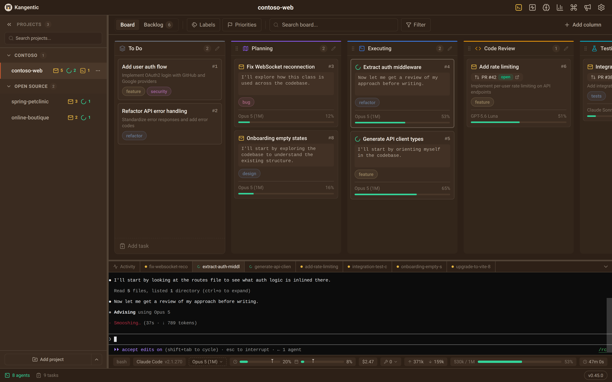

<!-- readme-translation source-blob=9c65bada5dcd25126a88e6b2728e7cb56ea71c6e -->
> Bu belge, [README.md](../README.md) dosyasının `9c65bad` revizyonundaki makine çevirisidir. Esas sürüm İngilizce olandır.

<p align="center">
  <a href="https://www.kangentic.com"></a>
</p>

<h1 align="center">Kangentic</h1>

<p align="center">
  <strong>Bir kartı sürükleyin. Bir ajan başlasın.</strong><br />
  Yapay zeka kodlama ajanları için ajan tabanlı bir geliştirme ortamı.
</p>

<p align="center">
  <a href="https://github.com/Kangentic/kangentic/releases/latest"></a>
  <a href="https://www.npmjs.com/package/kangentic"></a>
  <a href="../LICENSE"></a>
</p>

<p align="center">
  <a href="https://kangentic.github.io/kangentic/">
    <picture>
      <source media="(prefers-color-scheme: dark)" srcset="https://raw.githubusercontent.com/Kangentic/kangentic/main/docs/images/readme-board-dark.png" />
      <source media="(prefers-color-scheme: light)" srcset="https://raw.githubusercontent.com/Kangentic/kangentic/main/docs/images/readme-board-light.png" />
      
    </picture>
  </a>
</p>

<p align="center">
  <a href="https://kangentic.github.io/kangentic/">Canlı demo</a> |
  <a href="https://www.kangentic.com/getting-started/">Hızlı başlangıç</a> |
  <a href="https://www.kangentic.com/overview/">Belgeler</a>
</p>

<!-- language-switcher -->
<p align="center">
  <a href="../README.md">English</a> |
  <a href="README.zh-CN.md">中文(简体)</a> |
  <a href="README.zh-TW.md">中文(繁體)</a> |
  <a href="README.fr.md">Français</a> |
  <a href="README.de.md">Deutsch</a> |
  <a href="README.it.md">Italiano</a> |
  <a href="README.es.md">Español</a> |
  <a href="README.ja.md">日本語</a> |
  <a href="README.ko.md">한국어</a> |
  <a href="README.ru.md">Русский</a> |
  <a href="README.pt-BR.md">Português (Brasil)</a> |
  Türkçe |
  <a href="README.pl.md">Polski</a> |
  <a href="README.cs.md">Čeština</a> |
  <a href="README.hu.md">Magyar</a>
</p>
<!-- /language-switcher -->

## Ne yapar

Bir kodlama ajanı bir görevi tek başına yürütebilir, Git çalışma ağaçları da birkaçının aynı anda çalışmasını sağlar. Bu durumda sınır siz olursunuz: hangi ajan bir istem bekliyor, hangisi bitirdi, her dal nereye gitti. Kangentic her oturumu tek bir panoya yerleştirir ve size ihtiyaç duyanları işaretler.

### Ajanlarınızı tek panodan çalıştırın

- **Tek pano, tüm ajanlar.** Her kart modelini, bağlam penceresinin ne kadarının kullanıldığını ve ajanın son söylediğini gösterir; size ihtiyaç duyanlarda bir işaret bulunur.
- **Kangentic Mobile.** Telefonunuzu bir kez eşleştirin, ardından masanızdan uzaktayken ajanları kontrol edin, birinin takılıp kaldığı soruyu yanıtlayın ve diff'ini inceleyin. Bağlantı, Kangentic'in aktarıcısı veya sizin barındırdığınız bir aktarıcı üzerinden uçtan uca şifrelenir. [App Store](https://apps.apple.com/app/kangentic/id6794952339) veya [Google Play](https://play.google.com/store/apps/details?id=com.kangentic.mobile) üzerinden edinin.
- **On beş ajan CLI'ı.** Claude Code ile planlayın ve Codex ile geliştirin ya da her yerde tek bir CLI kullanın. Kangentic, zaten sahip olduğunuz CLI'ları zaten yapılandırdığınız kimlik bilgileriyle çalıştırır. API anahtarı yok, proxy yok, Kangentic hesabı yok.
- **Her proje tek yerde.** Her deponun kendi panosu vardır ve Ajan İzleyici hepsinde çalışan ajanları gösterir.
- **Panoda inceleyin.** Değişiklikler paneli her görevin diff'ini ve commit geçmişini gösterir. GitHub veya Azure DevOps üzerindeki bağlı bir pull request, durumunu ve birleştirmeye hazır olup olmadığını gösterir.
- **Ücretsiz ve açık kaynak.** AGPL-3.0; tüm özellikler dahildir ve ücretli katman yoktur.

### İş akışını şekillendirin

- **Sütunlar.** Pano, yazılımı yayımlama biçiminize uyana kadar sütunları yeniden adlandırın, ekleyin ve yeniden bağlayın. Her sütunun kendi ajanı, modeli, efor düzeyi ve izin modu vardır. Yapılandırma, depoyla birlikte `kangentic.json` içinde commit edilir; böylece ekip arkadaşlarınız aynı panoyu alır, görevler ve ajan oturumları ise her kişinin kendi makinesinde kalır.
- **Otomasyonlar.** Bir görev bir sütuna girdiğinde, ajanı bir turu bitirdiğinde veya görev sütundan çıktığında, sütun ajana bir mesaj ya da eğik çizgi komutu gönderebilir, bir betik çalıştırabilir, bir webhook çağırabilir, size bildirim gönderebilir veya görevi sonraki sütuna taşıyabilir. Bir ajanın denetlediği, düz sözcüklerle yazılmış bir koşul, bir adımın çalışıp çalışmayacağına karar verir.
- **İş akışları.** İş akışı ajanına bir özet verin, planladığı bağlantılı görevleri inceleyin ve Başlat'a basın. Her görev, beklediği görevler Tamamlandı sütununa ulaştığında başlar ve tek bir iş akışı birkaç projeye yayılabilir.
- **Panoda çalışan ajanlar.** Kangentic'in MCP sunucusu, çalışan bir ajanın görev oluşturmasını, kendi kartını taşımasını, geçmiş konuşmalarda arama yapmasını ve başka bir görevin ajanına mesaj göndermesini sağlar; böylece bir istemde yazılan bir kural işi ilerletebilir.

## Size uygun mu?

**Şu durumlarda size uygundur:**

- aynı anda birkaç kodlama ajanı çalıştırıyor ve hangisinin sizi beklediğini gözden kaçırıyorsanız.
- görevleri birkaç proje veya müşteri arasında idare ediyor ve tüm ajanları tek görünümde görmek istiyorsanız.
- Claude Code, Codex ve diğer CLI'ları zaten ödeme yaptığınız planlarda bir arada kullanmak istiyorsanız.
- çok adımlı bir iş akışınız varsa ve ajanlarını ve otomasyonlarını proje başına özelleştirmek istiyorsanız.
- uzaklaştığınızda ajanlarınıza telefonunuzdan yanıt vermek istiyorsanız.

**Şu durumlarda muhtemelen size göre değildir:**

- bir seferde tek bir görev üzerinde, başından sonuna kadar çalışmayı tercih ediyorsanız.
- tek bir projede çalışıyor ve nadiren geçiş yapıyorsanız.
- ajan CLI'ları kullanmıyorsanız veya Cursor ya da Claude Desktop gibi uygulamaları tercih ediyorsanız.
- geliştirme biçiminizde iş akışlarına veya otomasyonlara ihtiyacınız yoksa.
- ajanlarınızın makinenizde değil bulutta çalışmasını istiyorsanız.

Bu size yararlı görünüyorsa, bir ⭐ diğer geliştiricilerin Kangentic'i bulmasına yardımcı olur.

## Kurulum

```bash
npx kangentic
```

Bu komut, platformunuz için en son sürümü [GitHub Releases](https://github.com/Kangentic/kangentic/releases/latest) üzerinden indirir, kurar ve açar. Uygulama bundan sonra kendini günceller. Kendiniz çalıştırmayı tercih ederseniz yükleyiciler sürümler sayfasında da bulunur.

**Gereksinimler**

- Windows x64, Apple Silicon veya Intel üzerinde macOS 13 ya da üzeri veya Linux x64 ya da arm64 (`.deb` veya `.rpm`). Bilgi Grafiği Intel Mac'lerde kullanılamaz.
- `npx` için Node.js 20 veya üzeri ve Git 2.26 veya üzeri.
- Kurulu ve oturum açılmış en az bir [desteklenen ajan CLI'ı](#supported-agents).

WSL kullanıcıları Windows sürümünü kurar ve terminal kabuğu olarak bir WSL dağıtımı seçebilir. Ajanlar her CLI'ın Windows kurulumunu çalıştırır; bu nedenle yalnızca dağıtımın içine kurulan bir CLI bulunamaz. [Kurulum kılavuzu](https://www.kangentic.com/guide/installation/) her platformu ele alır.

## Nasıl çalışır

1. **Panonuzu yapılandırın.** Varsayılan sütunları koruyun veya yeniden şekillendirin ve her birinin çalıştıracağı ajanı ve izin modunu seçin.
2. **Bir görev oluşturun.** Görevlere bir başlık ve istem verin ya da GitHub Issues, GitHub Projects, Azure DevOps veya Asana üzerinden bir görev içe aktarın.
3. **Çalıştırmak için sürükleyin.** Kangentic çalışma ağacını oluşturur, sütunun izin modunu uygular ve ajanı başlatır.
4. **Kodlamasını izleyin.** Ajanı canlı terminalinde takip edin, sorduğunda yanıtlayın ve işi bittiğinde kartı sürükleyerek ilerletin.

<a name="supported-agents"></a>
## Desteklenen ajanlar

[Claude Code](https://docs.anthropic.com/en/docs/claude-code), [Codex CLI](https://developers.openai.com/codex/cli), [Gemini CLI](https://github.com/google-gemini/gemini-cli), [Cursor CLI](https://cursor.com/docs/cli/overview), [GitHub Copilot CLI](https://docs.github.com/en/copilot/how-tos/copilot-cli/cli-getting-started), [Grok Build](https://github.com/xai-org/grok-build), [Antigravity CLI](https://antigravity.google/docs/cli/getting-started), [Goose CLI](https://github.com/aaif-goose/goose), [OpenCode](https://opencode.ai/docs), [Aider](https://aider.chat/), [Qwen Code](https://github.com/QwenLM/qwen-code), [Kimi Code](https://github.com/MoonshotAI/kimi-code), [Factory Droid](https://docs.factory.ai/cli/getting-started/overview), [Warp (Oz CLI)](https://docs.warp.dev/reference/cli/cli) ve yerel modeller için tek turlu sohbet olarak [Ollama](https://ollama.com).

Yeniden başlatmadan sonra devam etme, MCP pano araçları ve geçmişi sonraki ajana devretme CLI'a bağlıdır. [Her ajanın neleri desteklediğine](https://www.kangentic.com/features/agent-orchestration/#supported-agents) bakın.

## Diller

Kangentic'in arayüzü, bu sayfanın üstünde listelenen her dilde sunulur. Dili Settings > Language altından değiştirin; Kangentic o dilde yeniden başlar. Çeviriler makine tarafından yapılır ve incelemeye açıktır; [Çeviriler](../docs/contributing/translations.md) bir çevirinin nasıl düzeltileceğini açıklar.

## Veriler ve gizlilik

Panolarınız, görevleriniz ve dökümleriniz yerel bir SQLite veritabanında kalır. Ajan CLI'ları, terminalinizde yaptıkları gibi kendi hesaplarınız altında kendi sağlayıcılarına bağlanır.

Sürüm derlemeleri varsayılan olarak anonim kullanım olayları (Aptabase) ve hata raporları (Sentry) gönderir. Kullanım olayları hiçbir zaman görev metni, istem veya kod içermez. İkisini de kapatmak için `KANGENTIC_TELEMETRY=0`, yalnızca hata raporlarını kapatmak için `KANGENTIC_ERROR_REPORTING=0` ayarlayın. Uygulama içinde bir anahtar yoktur. Uygulama ayrıca güncellemeler ve duyurular için GitHub'ı denetler. Tam liste için [gizlilik politikasına](https://www.kangentic.com/privacy/) bakın.

## Belgeler

[Hızlı başlangıçla](https://www.kangentic.com/getting-started/) başlayın, ardından sütunlar, otomasyonlar, iş akışları, MCP sunucusu ve yapılandırma için [belgelere](https://www.kangentic.com/overview/) geçin.

## Geliştirme

Kaynaktan derlemek için Node.js 22.14 veya üzeri ya da 24 veya üzeri gerekir.

```bash
git clone https://github.com/Kangentic/kangentic.git
cd kangentic
npm install
npm start
```

## Katkıda bulunma

Proje yapısı, testler ve kurallar için [CONTRIBUTING.md](../CONTRIBUTING.md) dosyasına bakın. Katkıda bulunanlar, ilk pull request'leri birleştirilmeden önce bir [CLA](../CLA.md) imzalar.

## Destek

- Sorular ve özellik istekleri için [GitHub Discussions](https://github.com/Kangentic/kangentic/discussions)
- Hata bildirimleri için [GitHub Issues](https://github.com/Kangentic/kangentic/issues)
- Herkese açık paylaşım yapmak istemiyorsanız [support@kangentic.com](mailto:support@kangentic.com)

Bir güvenlik sorununu bildirmek için [SECURITY.md](../SECURITY.md) dosyasına bakın.

## Lisans

[AGPL-3.0](../LICENSE). Ticari lisans için licensing@kangentic.com adresine e-posta gönderin.
